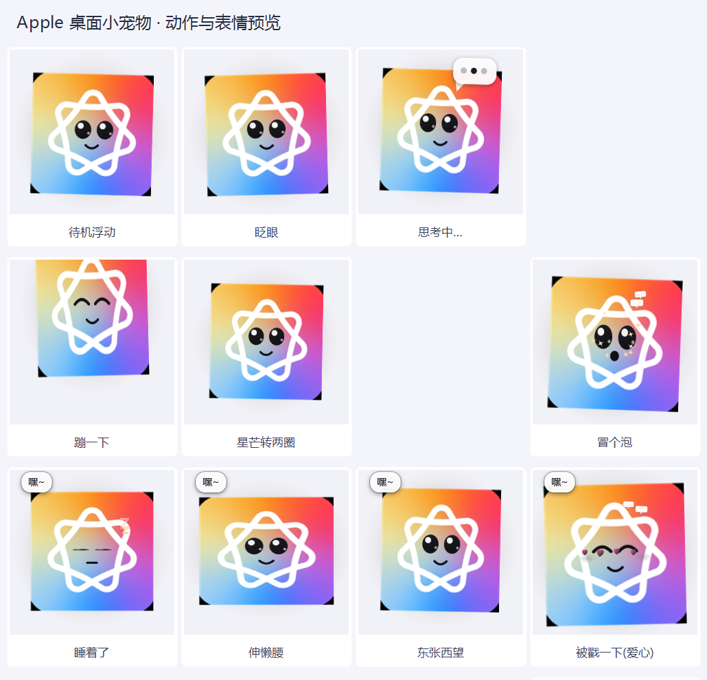

# Apple Intelligence 桌面小宠物 ✨

一只趴在你桌面上的 **Apple Intelligence** 小宠物：**彩虹渐变圆角方块 + 白色七环结**（直接用官方图标作为身体素材），中间是一张会眨眼的笑脸。会浮动、转圈、思考、睡着，还能和其他十只 AI 桌宠**打招呼、聊天、吵架和好、一对一打架**。

- **零依赖**：只用 Windows 自带的 WPF + PowerShell
- **不抢焦点**：`WS_EX_NOACTIVATE | WS_EX_TOOLWINDOW`

## 快速开始
1. 双击 **`启动宠物.vbs`**（无控制台），出现在屏幕右下角；被拦截就用 **`启动宠物.bat`**
2. 左键点一下 = 戳它 · 拖动 = 换位置 · 右键 = 菜单（打招呼 / 摸摸头 / **挑战最近的宠物 ⚔** / 大小 / 退出）
3. 开机自启：`启动宠物.vbs` 的快捷方式丢进 `shell:startup`

## 跟别的不太一样的地方
这只的**身体不是矢量画的**，而是直接用了 `apple_body.png`（由官方图标裁切缩放而来）。改 `build\b_xaml.txt` 里那行 `<Image ... Source="{BODYIMG}" .../>` 就能换素材（`{BODYIMG}` 由 `build.ps1` 替换成本地绝对路径）。

> 图标素材版权归 Apple 所有，这里仅作个人桌面装饰使用。

## 联动 / 对战
共享内存 `DesktopPets.Interop.v5`（10 槽位）。对战：右键「挑战最近的宠物 ⚔」，或靠近时约 4% 概率自动开打（双方各 100 血，伤害 9~19）。台词都在 `lines.json`。

## License
MIT（代码部分）